# Mountain Drop

**Low-poly off-road descent in the browser.** Start on the snowy summit of a huge mountain in
a 4x4 jeep and find your way down to the village by the lake — about 1600 m of drop and 8 × 8
km of free roam. No timer and no checkpoints: follow the trails carved into the slopes, cut
across meadows and scree, snap young trees on the way, leave your tracks in the snow. Works on
desktop and on phones (landscape, touch or tilt), installable as a PWA and playable offline.

**▶ Play: https://carlogio08.github.io/Auto/** (see [Deployment](#deployment) — the address
follows the repository name, e.g. `/mountain-drop/` if the repository is renamed)


| On the trail                                   | Off the trail, tyre tracks                              |
| ---------------------------------------------- | ------------------------------------------------------- |
| 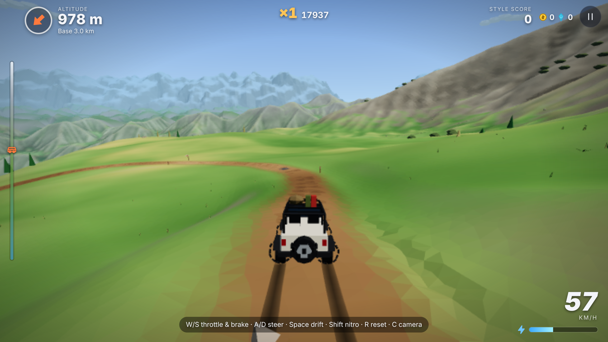   | 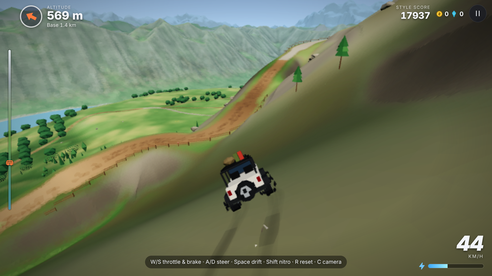       |
| **Summit start**                               | **Forest, destructible trees**                          |
| 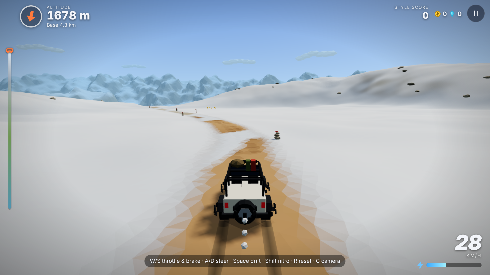 | 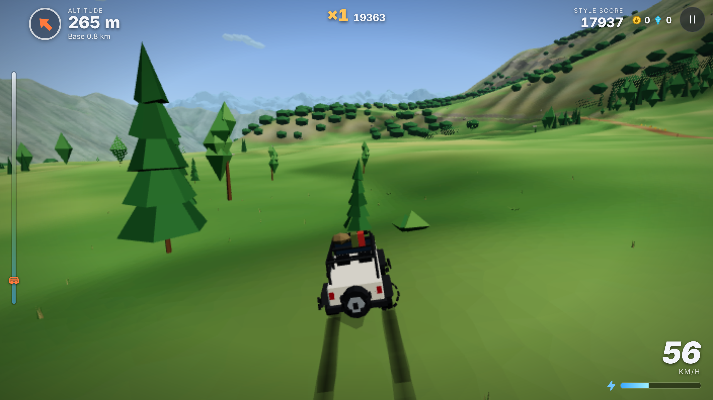            |
| **Garage (test coins, accessories, paints)**   | **Results**                                             |
|  |         |
| **Mobile (landscape, touch)**                  | **Mobile off-road**                                     |
| 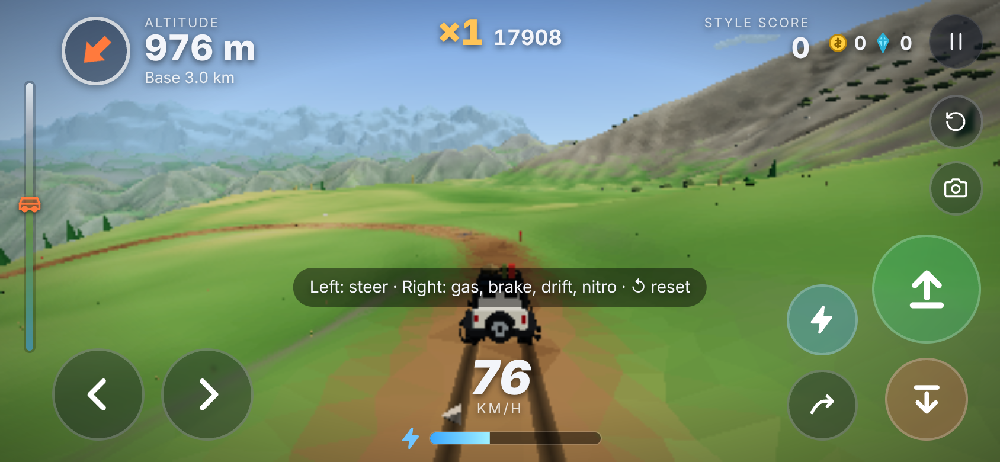   | 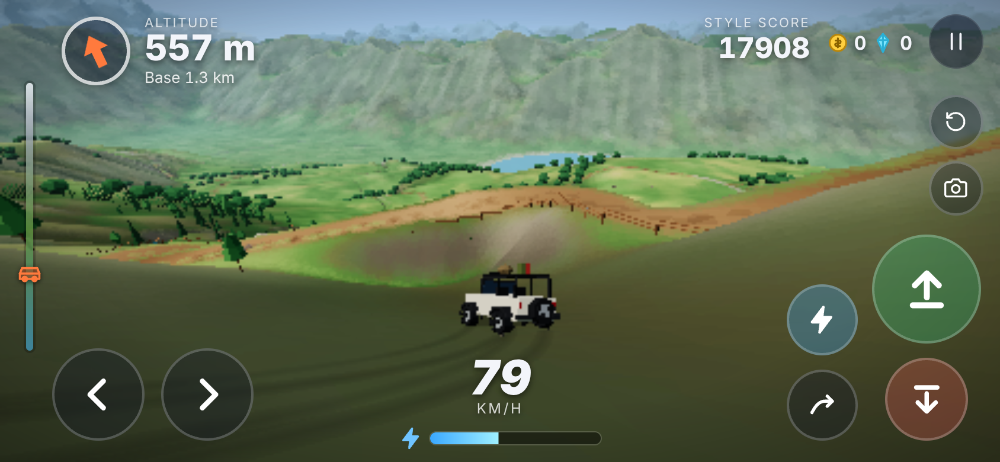 |

### Before / after (landscape update, same seed, position and camera)

| Before                                                               | After                                                              |
| -------------------------------------------------------------------- | ------------------------------------------------------------------ |
| 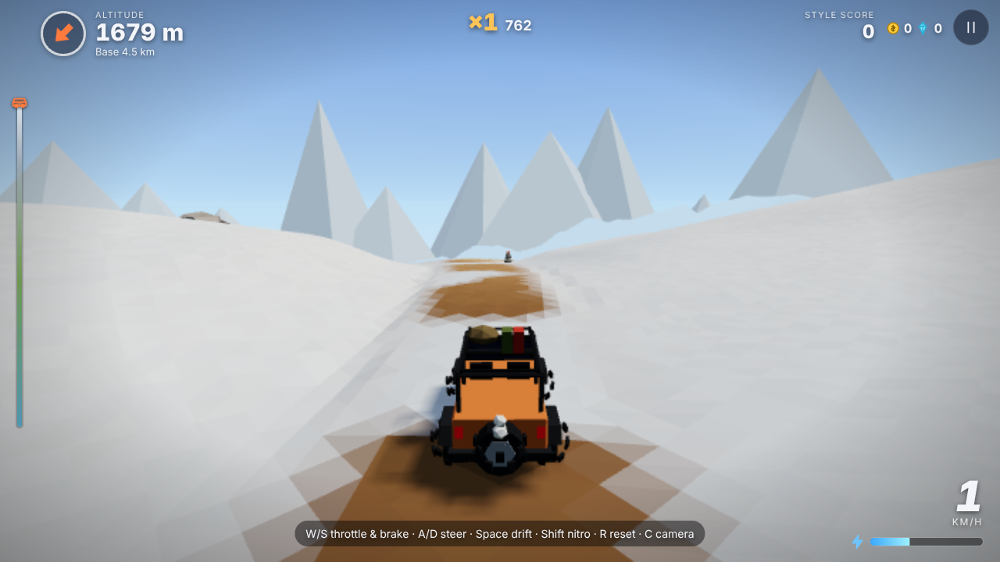 | 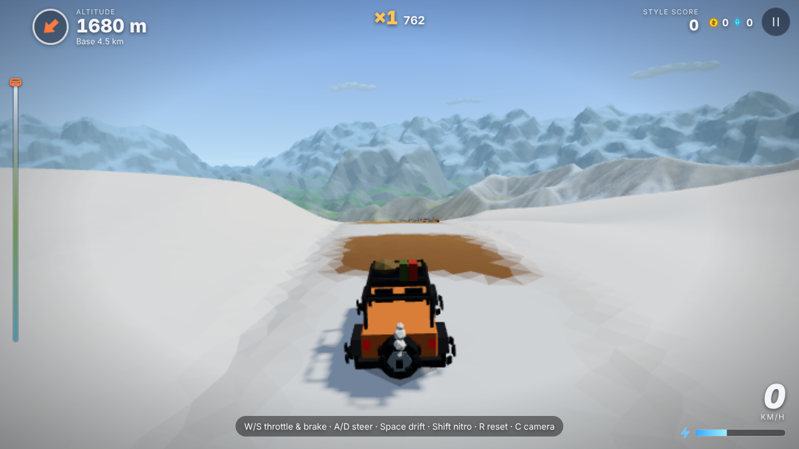 |
| 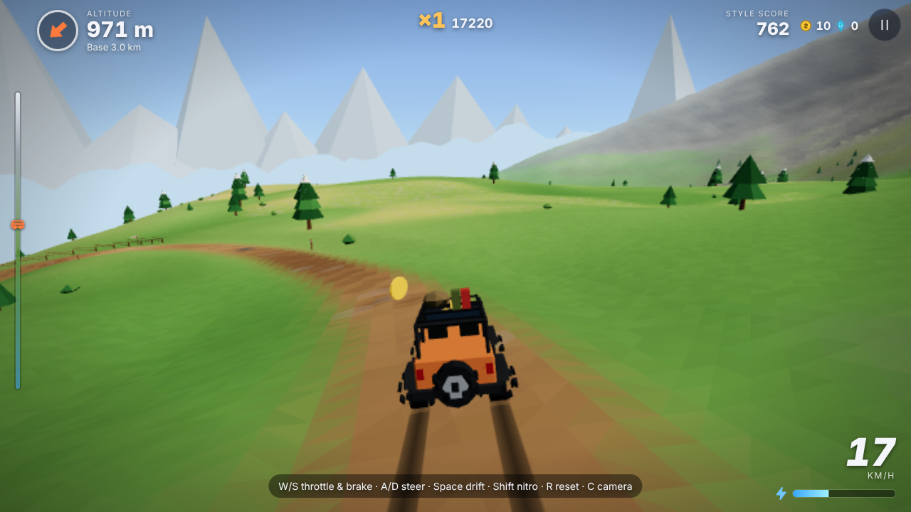   | 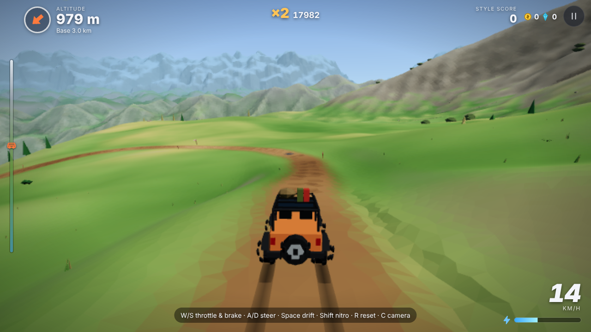   |
| 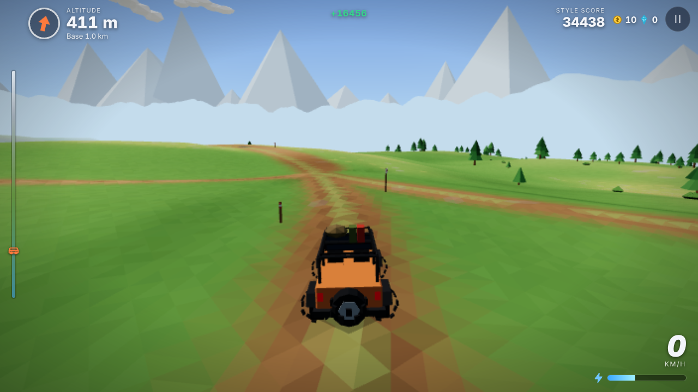 | 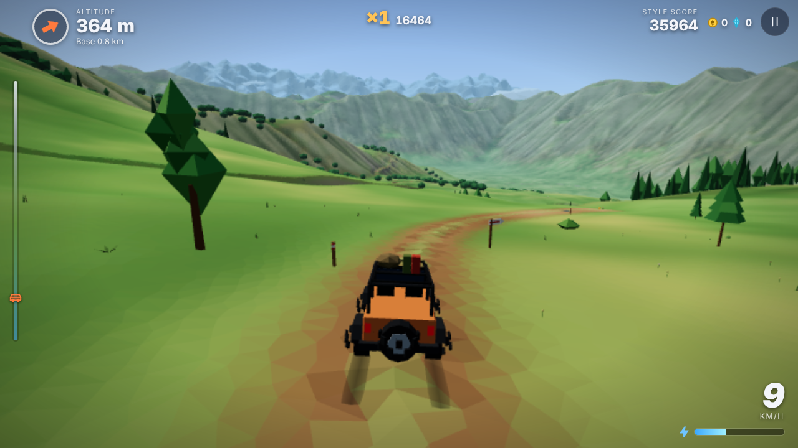 |
| 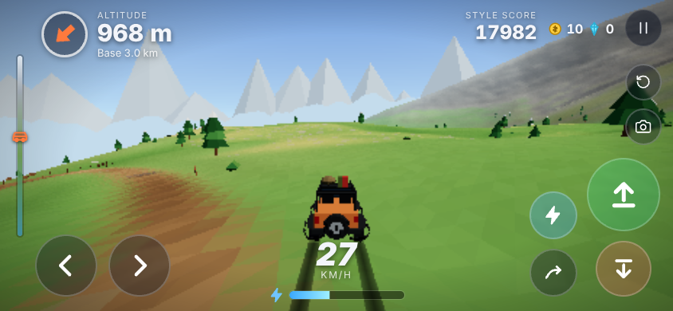   | 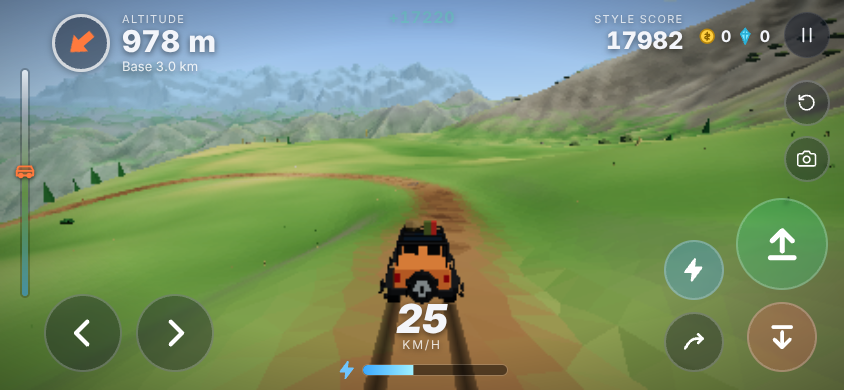   |

## Features

- **Distant ranges and atmosphere**: a far-field ring of terrain to ~20 km built from the
  same landforms plus distant ranges in the data; aerial perspective (ridges fade into the
  sky's blue in tone steps) and height fog thick in the valleys, sun halo, clouds on three
  layers — no painted backdrop, no fog band.
- **Real forests**: tree species with realistic heights (6–25 m), Poisson-disk woods with
  glades and soft edges by ecology, larches and dwarf pines at the tree line, undergrowth
  near the jeep, canopy masses far away, dithered LOD transitions.

- **A designed, organic mountain**: data-driven landforms (crests, valleys, cirques,
  terraces, high meadows, saddles, steep faces, foothills, lake basin) blended with smooth
  min/max, baked into a heightmap and eroded (talus, thermal, flow routing and stream
  incision) in a Web Worker. About a quarter of the ground is flat, most of it gentle or
  medium, a quarter steep, almost no walls.
- **Small, well-shaped faces**: ~0.85 m flat-shaded triangles around the jeep (1.25 / 2 m on
  medium / low), jittered so no stripes show, refined on steep slopes; varied relief by zone
  (spurs, terraces, gullies, hummocks, moraines); smooth low-frequency colours with baked
  ambient occlusion.
- **Organic trails carved into the terrain**: minimum-cost routing that follows contours,
  terraces, saddles and valley floors; hairpins only where needed; 4–7 m wide with lay-bys
  and viewpoints, camber, ditches and embankments; packed dirt, gravel, grassy two-tracks,
  ruts, puddles, snow; wooden bridges and fords. Leave them whenever you like.
- **Rich, smoothly blended colours**: ramps of tones per material (61 colours for the terrain)
  splatted per vertex from altitude, slope, aspect, curvature, wetness and the snow line;
  re-themed by time of day and weather. No textures.
- **Tyre tracks** that follow the ground: grooves in the snow, dark mud, crushed grass,
  scratches on gravel, fading after a minute or two.
- **Ecological props**: forests in valleys and on medium slopes, open meadows, a thin tree
  line; few rocks, only where they belong (outcrops, scree, stream beds).
- **4x4 jeeps** (Trailblazer, Scout, Crawler, Nomad): low centre of mass, stiff long-travel
  suspension that does not bounce, tolerant tyres, engine braking, ground stick, anti-flip on
  the ground and **no air control**. Paints, accessories and upgrades in the garage.
- **Destructible trees**, a **camera made for descents**, **Free descent** and **Daily
  challenge** modes, style combos, nitro, coins, crystals, boulders and rockslides.
- **Mobile first**: multitouch buttons or tilt, auto-accelerate option, vibration, safe
  areas, fullscreen, adaptive quality and dynamic resolution. **English and Italian**.

## Controls

| Action            | Keyboard   | Gamepad     | Touch              |
| ----------------- | ---------- | ----------- | ------------------ |
| Throttle          | W / ↑      | RT          | ⬆ (right)          |
| Brake / reverse   | S / ↓      | LT          | ⬇ (right)          |
| Steer             | A D / ← →  | Left stick  | ◀ ▶ (left) or tilt |
| Handbrake / drift | Space      | X / RB      | ↪                  |
| Nitro             | Shift      | A           | ⚡                 |
| Back to safe spot | R          | View        | ↺                  |
| Change camera     | C          | Y           | 📷                 |
| Free look         | Mouse drag | Right stick | Drag on the view   |
| Pause             | P / Esc    | Menu        | ❚❚                 |

`R` puts the jeep back on the last safe spot (sampled automatically) facing downhill; press
again to go further back. It also happens on its own if you stay upside down, sink in deep
water or leave the map. Keys can be rebound in **Settings → Controls**; camera distance,
height, field of view and shake, and the tyre tracks (Off / Low / High) are in **Settings**.

## Run locally

Requirements: Node.js 20+.

```bash
npm install
npm run dev
```

Open http://localhost:5173. Other scripts:

```bash
npm run build     # type-check + production build in dist/
npm run preview   # serve the build on http://localhost:4173
npm test          # unit/integration tests (Vitest)
npm run lint      # ESLint + Prettier check
npm run e2e       # Playwright smoke test + screenshots (needs `npm run preview` running)
```

Debug helpers: `?autopilot` (the built-in driver follows the main trail), `?e2e` (skips the
fly-over and exposes `window.__md`), **F3** (FPS / draw-call overlay), **F4** in dev builds or
with `?debug` (map of slopes, trails, fords, landforms and the jeep).
`node scripts/compare-screenshots.mjs <label>` captures fixed viewpoints (needs the preview
server) for before/after comparisons.

## Tuning

Everything lives in [`src/config.ts`](src/config.ts) (grouped by area, plus feature flags);
per-jeep values are in [`src/data/cars/`](src/data/cars), mountains and their landforms in
[`src/data/mountains/`](src/data/mountains), tree tiers in
[`src/data/trees.ts`](src/data/trees.ts), colours in [`src/data/palette.ts`](src/data/palette.ts).
The most useful knobs for the driving feel:

| Parameter                                              | Effect                                                     |
| ------------------------------------------------------ | ---------------------------------------------------------- |
| `driving.speedScale`                                   | Speed of every jeep (1.35 = 35 % faster top speed).        |
| `driving.gripScale` / jeep `tires.grip`                | Overall grip: raise for control, lower for slides.         |
| `driving.slideFactor` / `slideFalloff`                 | How much grip is left past the peak (tolerance of slides). |
| `driving.handbrakeGrip` / `handbrakeYaw`               | How eagerly the tail steps out on the handbrake.           |
| jeep `groundStick`, `physics.stickRampIn`              | How glued the jeep stays over crests and after landings.   |
| jeep `suspension.dampingRebound`, `antiRoll*`          | Bounce and body roll.                                      |
| jeep `aero.drag`, `engine.engineBrake`                 | Top speed on the flat and speed held on long descents.     |
| `camera.chaseDistance` / `chaseHeight` / `descentLift` | Framing of the slope ahead.                                |

## Code structure

```
src/
  core/      context, loop (fixed step), stateMachine, eventBus, save, i18n, renderer, settings
  data/      mountains (+ daily generator), jeeps, palette & themes, surfaces, trees, objectives,
             upgrades, hazards, environment, modes, achievements, registry
  input/     actions, input manager, keyboard, gamepad, touch, tilt, pointer free look
  terrain/   landforms, generator (heightmap + erosion), heightfield, mountain, trail router,
             road, terrain (carving), biome model, splat colours, patch builder, quadtree mesh,
             terrain worker + service, course (placement)
  vehicle/   physics, jeep model, telemetry, camera rig, autopilot, vehicle
  world/     world, props (placement + streamed instancing), structures, colliders, debris, sky,
             lighting, water, weather
  systems/   nitro, style, hazards, collectibles, trees, objectives, medals, achievements
  effects/   instanced shards (particle kinds), tyre tracks, speed lines, CSS post-fx
  audio/     audio engine (mixer), engine sound, sfx, music, director
  game/      run session, progression, menu backdrop, garage scene
  ui/        UI manager (focus navigation), screens, HUD, components, icons, theme.css
  states/    boot, main menu, garage, mountain select, loading, playing, paused, results
  main.ts
```

Read [ARCHITECTURE.md](ARCHITECTURE.md) for the module diagram, the terrain/trail maths, the
physics and the performance strategy, and [CONTRIBUTING.md](CONTRIBUTING.md) for step-by-step
guides to add a mountain, a jeep, a hazard, a palette theme, a mechanic or a language.

## Before release (Prima del rilascio)

The build currently ships with **test coins** so every paid item can be tried:

```ts
// src/config.ts
dev: {
  testCoins: 100000, // coins for new profiles, top-up of existing saves, "Test" button
  unlockAll: true,   // achievement-locked jeeps can be bought
},
```

Before releasing set `testCoins: 0` and `unlockAll: false`. With `testCoins` at 0 new
profiles start with 0 coins, the save migration no longer tops anything up and the "Test:
reset coins" button disappears from the settings. Profiles that already received the test
coins keep them: to start clean, use **Settings → Reset all progress** (or bump the save schema
with a migration that resets `coins`).

## Deployment

`.github/workflows/deploy.yml` runs lint, tests and the build on every push and pull
request, and deploys `dist/` to GitHub Pages on every push to `main`. The base path is taken
from the repository name automatically.

One-time setup on GitHub: the repository must be **public** (or on a plan with private
Pages), and **Settings → Pages → Build and deployment → Source** must be **GitHub Actions**.

## Roadmap

- More mountains and an in-browser editor for trails and biomes.
- Online leaderboards for the daily challenge.
- Photo mode and replays with a free camera.
- Rain and mud, seasonal palettes, wildlife.
- Cosmetics: decals, wheels, horns.

## License

[MIT](LICENSE)
