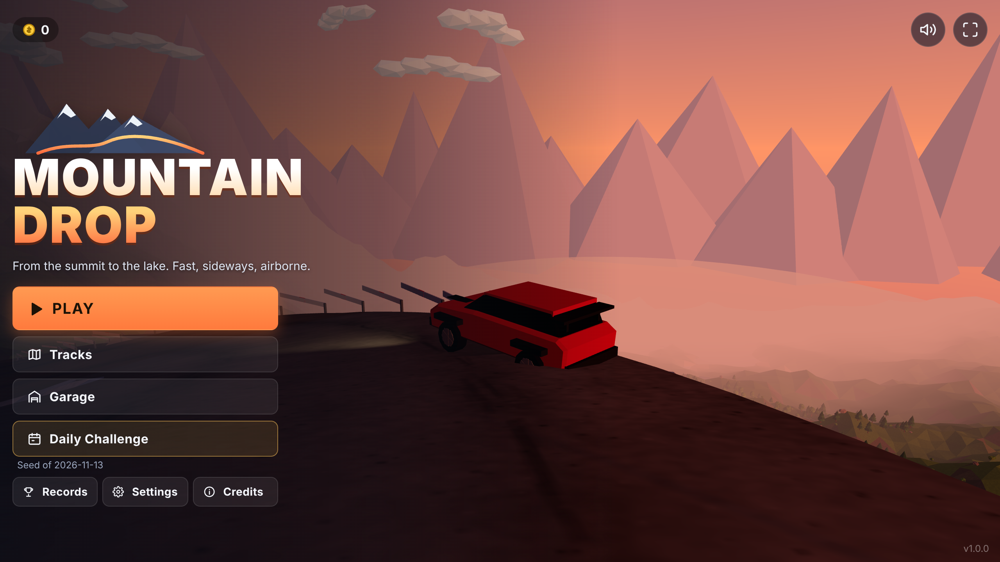
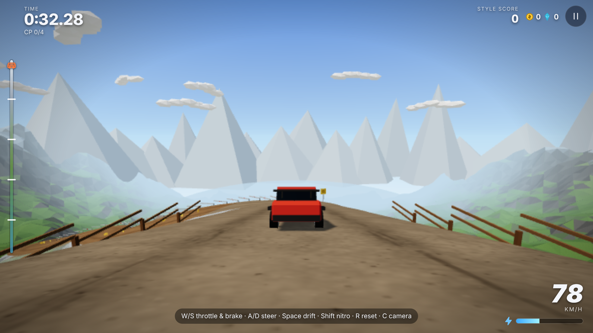
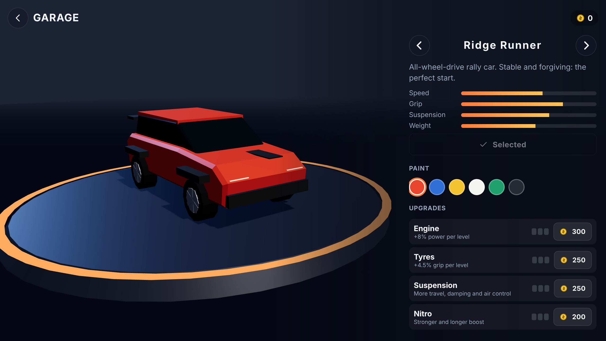
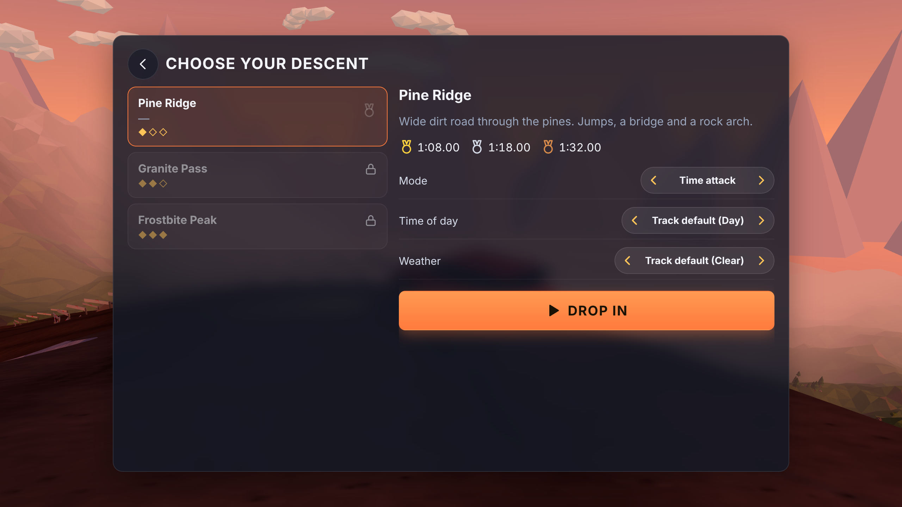
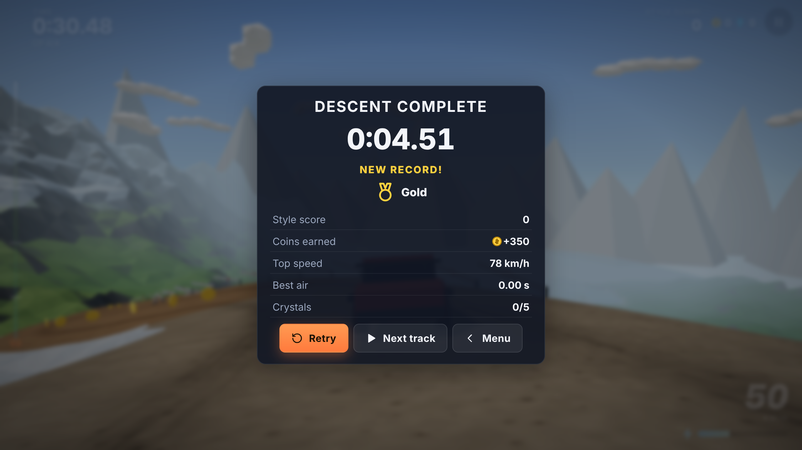
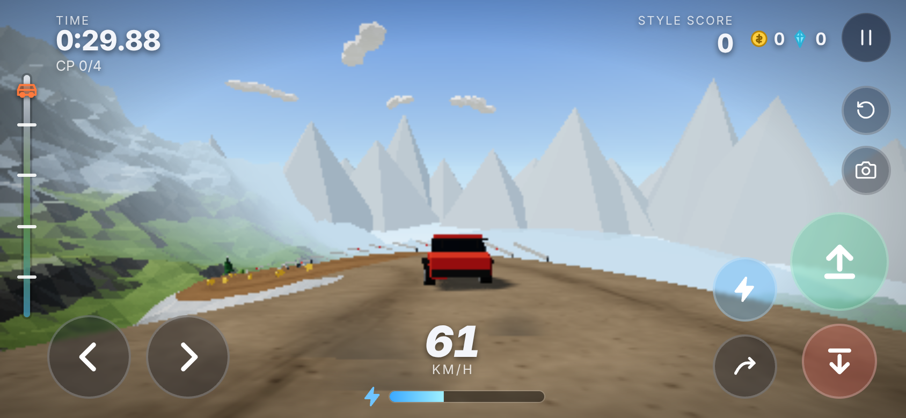
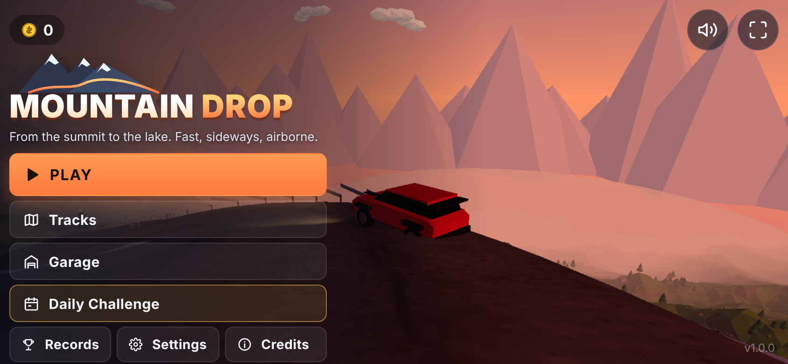

# Mountain Drop

**Low-poly downhill driving game in the browser.** Drive a car with real suspension from the
summit of a mountain down to the lake, as fast and with as much style as you can: drifts on
the hairpins, jumps, flips, near misses and risky off-road shortcuts. Works on desktop and
on phones (landscape, touch or tilt), installable as a PWA and playable offline.

**▶ Play: https://carlogio08.github.io/Auto/** (see [Deployment](#deployment) — the address
follows the repository name, e.g. `/mountain-drop/` if the repository is renamed)



| Race                                             | Garage                                           |
| ------------------------------------------------ | ------------------------------------------------ |
|        |    |
| **Track select**                                 | **Results**                                      |
|    |  |
| **Mobile (landscape, touch)**                    | **Mobile menu**                                  |
|  |  |

## Features

- **Physics at 120 Hz** with interpolated rendering: raycast suspension per wheel (spring,
  bump/rebound damping, anti-roll bars), slip-angle tyres with a friction circle, handbrake
  drifts, downforce and drag, air control, auto-righting, chassis collisions.
- **Procedural mountains**: analytic `height(x, z)`, switchback roads with hairpins, cuts and
  fills, jumps, bumps, a river with bridges, a rock arch, shortcuts and a lake at the bottom.
- **3 tracks + daily challenge** (same procedural mountain for everyone on a given day), time
  attack and free ride modes, medals, ghost of your best run.
- **4 cars** with different personalities (stable AWD, RWD drifter, light jumper, heavy
  truck), paint jobs and upgrades (engine, tyres, suspension, nitro).
- **Style system**: drifts, air, flips, barrel rolls, perfect landings, near misses and
  shortcuts build a combo multiplier; crash and you lose it. Nitro refills with style.
- **Hazards**: rolling boulders, rockslides, fallen logs, mud pools, ice patches, narrow bridges.
- **Low-poly art, no assets**: every mesh, texture (canvas), icon (SVG) and sound (WebAudio)
  is generated in code. Times of day (dawn, day, sunset, night with headlights), weather
  (clear, fog, snow).
- **Mobile first**: multitouch buttons or tilt steering, auto-accelerate option, vibration,
  safe areas, fullscreen, adaptive quality and dynamic resolution.
- **English and Italian**, chosen from the browser language.

## Controls

| Action              | Keyboard  | Gamepad    | Touch              |
| ------------------- | --------- | ---------- | ------------------ |
| Throttle            | W / ↑     | RT         | ⬆ (right)          |
| Brake / reverse     | S / ↓     | LT         | ⬇ (right)          |
| Steer               | A D / ← → | Left stick | ◀ ▶ (left) or tilt |
| Handbrake / drift   | Space     | X / RB     | ↪                  |
| Nitro               | Shift     | A          | ⚡                 |
| Reset to checkpoint | R         | View       | ↺                  |
| Change camera       | C         | Y          | 📷                 |
| Pause               | P / Esc   | Menu       | ❚❚                 |

In the air, release and press throttle/brake to pitch, steer to roll (hold the handbrake to
yaw instead). Keys can be rebound in **Settings → Controls**. Menus work with mouse, touch,
keyboard (arrows + Enter/Esc) and gamepad (D-pad + A/B).

## Run locally

Requirements: Node.js 20+.

```bash
npm install
npm run dev
```

Open http://localhost:5173. Other scripts:

```bash
npm run build     # type-check + production build in dist/
npm run preview   # serve the build on http://localhost:4173
npm test          # unit/integration tests (Vitest)
npm run lint      # ESLint + Prettier check
npm run e2e       # Playwright smoke test + screenshots (needs `npm run preview` running)
```

Debug helpers: `?autopilot` (the built-in driver races), `?e2e` (exposes `window.__md`),
**F3** (FPS / draw-call overlay).

## Tuning

Everything lives in [`src/config.ts`](src/config.ts) (grouped by area, plus feature flags);
per-car values are in [`src/data/cars/`](src/data/cars). The five most useful knobs for the
driving feel:

| Parameter                                                    | Effect                                                                |
| ------------------------------------------------------------ | --------------------------------------------------------------------- |
| `physics.gravity` (15)                                       | Higher = snappier jumps and faster descents, lower = floatier.        |
| `driving.gripScale` (1.0)                                    | Global tyre grip: raise for control, lower for chaos.                 |
| `driving.handbrakeGrip` (0.3) + `driving.handbrakeYaw` (2.6) | How eagerly the tail steps out on the handbrake.                      |
| `driving.minSteerFactor` (0.3) / `steerFalloffSpeed` (38)    | Steering reduction at speed (stability vs agility).                   |
| car `aero.drag`                                              | Top speed: terminal velocity is where drag balances gravity + engine. |

## Code structure

```
src/
  core/      context, loop (fixed step), stateMachine, eventBus, save, i18n, renderer, settings
  data/      cars, tracks (+ daily generator), upgrades, surfaces, hazards, environment, modes, achievements, registry
  input/     actions, input manager, keyboard, gamepad, touch, tilt
  terrain/   mountain (natural height), road (generator, profile, spatial queries), terrain (carving),
             course (placement), terrain/road meshes, canvas textures
  vehicle/   physics, model, telemetry, camera rig, autopilot, vehicle
  world/     world, props (instancing), structures, colliders, sky, lighting, water, weather
  systems/   checkpoints, nitro, style, hazards, collectibles, ghost, medals, achievements
  effects/   particles, skidmarks, speed lines, CSS post-fx
  audio/     audio engine (mixer), engine sound, sfx, music, director
  game/      run session, progression, menu backdrop, garage scene
  ui/        UI manager (focus navigation), screens, HUD, components, icons, theme.css
  states/    boot, main menu, garage, track select, loading, playing, paused, results
  main.ts
```

Read [ARCHITECTURE.md](ARCHITECTURE.md) for the module diagram, the physics formulas and the
performance strategy, and [CONTRIBUTING.md](CONTRIBUTING.md) for step-by-step guides to add a
car, a track, an upgrade, a hazard, a mechanic or a language.

## Deployment

`.github/workflows/deploy.yml` runs lint, tests and the build on every push and pull
request, and deploys `dist/` to GitHub Pages on every push to `main`. The base path is taken
from the repository name automatically.

One-time setup on GitHub: the repository must be **public** (or on a plan with private
Pages), and **Settings → Pages → Build and deployment → Source** must be **GitHub Actions**.

## Roadmap

- More tracks and a track editor using the same data format.
- Online leaderboards and shareable ghost codes for the daily challenge.
- Replays with free camera; photo mode.
- More weather (rain, mud spray on the camera), night-time torches and lamps along the road.
- Cosmetics: decals, wheels, horns.
- Split-screen local multiplayer.

## License

[MIT](LICENSE)
